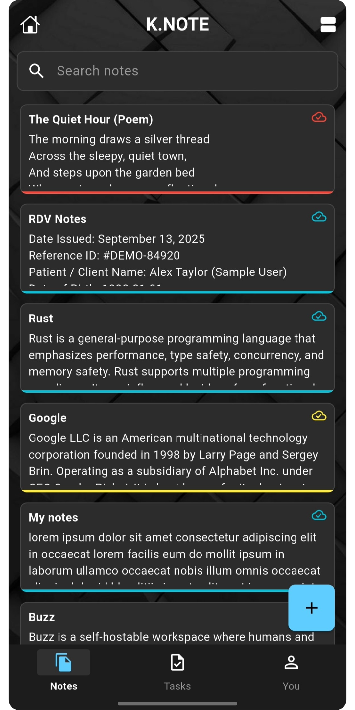
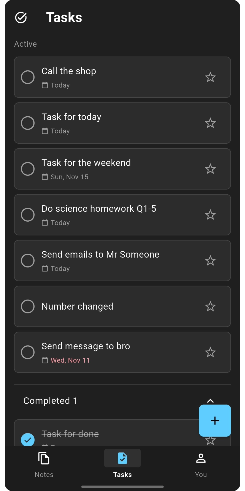
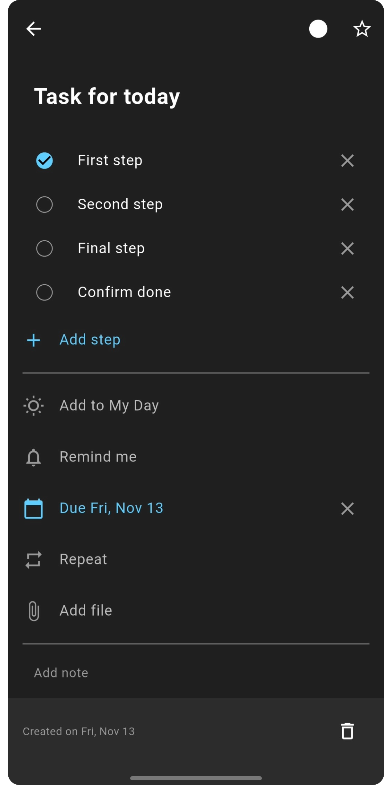

# KNOTE

[](https://github.com/lordyhas/k.note/actions/workflows/flutter_ci.yml)
[](https://github.com/lordyhas/k.note/releases/latest)
[](LICENSE)

KNOTE is an open-source notes and tasks app for Android and the web, built with Flutter and Firebase. iOS is planned: the project is there but not configured or tested yet.

<p align="center">
  
  
  
</p>

- **Notes**: rich-text editor, colors, search, archive and trash with undo. Changes save automatically as you type.
- **Tasks**: quick add, due dates, reminders (notifications on Android), repeat rules (daily, weekdays, custom: completing a repeating task adds the next one), a "My Day" list and a collapsible completed section.
- **Calendar**: a month view of your tasks by due date.
- **Sync**: your notes and tasks follow your account across devices through Cloud Firestore, and stay available offline thanks to Firestore's cache.
- **Accounts**: sign in with email/password (the address must be verified) or Google, reset a forgotten password, delete your account and all its data from the settings.
- **Profile and preferences**: set your display name, and choose the language, the notes layout, task reminders, the default reminder time and the first day of the week. Preferences are saved to your account and follow you on every device.
- **Feedback**: send a message to the team from the settings.
- **Private by design**: Firestore security rules ensure each user can only read and write their own data.
- **Languages**: English and French, following the device language.
- **Responsive**: a bottom bar on phones, a rail or a side pane on tablets and wide browser windows.

---

## Download

Get the latest Android APK from the [releases page](https://github.com/lordyhas/k.note/releases/latest)
(`knote-v<version>.apk`). The `.aab` file next to it is the bundle for Google Play.

## Prerequisites

- Flutter SDK compatible with `sdk: >=3.1.4 <4.0.0`.
- Dart SDK (bundled with Flutter).
- Firebase project configured for the target platform.
- For Android builds: JDK 17 and `android/app/google-services.json` (not committed).

## Installation

```bash
git clone https://github.com/lordyhas/k.note.git
cd k.note
flutter pub get
```

---

## Run

### Default (connected device/emulator)
```bash
flutter run
```

### Platform-specific examples
```bash
flutter run -d chrome      # Web
flutter run -d android     # Android
```

### Build examples
```bash
flutter build apk --release        # build/app/outputs/flutter-apk/app-release.apk
flutter build appbundle --release  # build/app/outputs/bundle/release/app-release.aab
flutter build web                  # build/web/
```

> Android and the web are the supported platforms. `firebase_options.dart` throws `UnsupportedError` on iOS, macOS, Windows and Linux.

### iOS (work in progress)

The `ios/` folder is the default Flutter iOS project (bundle ID `com.kdynamic.knote`, display name KNOTE). It has never been built or tested on a Mac or an iPhone, and Firebase is not configured for it yet. Still to do:

- Register an iOS app in Firebase and re-run the FlutterFire CLI (`flutterfire configure`) to add iOS to `lib/firebase_options.dart` and get `ios/Runner/GoogleService-Info.plist`.
- Add the Google Sign-In URL scheme and the notification setup to the Runner project.
- Build and test on a Mac (`flutter run -d ios`).

---

## Configuration

### Firebase

- App startup always calls `Firebase.initializeApp(options: DefaultFirebaseOptions.currentPlatform)`.
- Firebase options are hard-coded in `lib/firebase_options.dart` (generated by FlutterFire CLI).
- Firestore collections used by the app are rooted under:
  - `users/{userId}/notes`
  - `users/{userId}/tasks`
- Access control lives in `firestore.rules` (each user can only reach their own `{userId}`). Deploy it with `npx firebase-tools deploy --only firestore:rules`. See [docs/security.md](docs/security.md).

### Secrets and platform files

- `android/app/google-services.json` is ignored by Git and must be provided locally.
- Firebase API keys are public identifiers, not secrets: security comes from the Firestore rules (see [docs/security.md](docs/security.md)).

---

## Useful commands

```bash
flutter pub get
flutter analyze --no-fatal-warnings --no-fatal-infos
flutter test
dart format .
flutter run --release                 # release mode; add -d <device_id> to pick a device
cd test/firestore_rules && npm ci && npm test   # security rules tests (Firestore emulator, needs Java)
```

SHA fingerprints to register in Firebase (use the `keytool` from your JDK):

```bash
keytool -list -v -keystore ~/.android/debug.keystore -alias androiddebugkey -storepass android -keypass android
```

```bash
keytool -list -v -keystore /path/to/upload-keystore.jks
```

CI uses GitHub Actions (`.github/workflows/flutter_ci.yml`): it runs `flutter pub get`, `flutter analyze` and `flutter test`, plus the Firestore rules tests, on pushes/PRs targeting `main`, `master`, `dev`, `dev-new-ui` and `production`. Merging into `production` also builds a signed app bundle and APK and publishes them as a GitHub release (`release.yml`, see [docs/release.md](docs/release.md)).

---

## Project structure (overview)

```text
lib/
  main.dart                      # App entrypoint, Firebase init, AuthRepository and blocs
  config/                        # Asset paths
  routing/router.dart            # go_router tree + auth-aware redirects
  domain/models/                 # Note, task, user models
  data/
    repositories/                # AuthRepository
    services/                    # FirestoreService
  ui/
    core/                        # Theme, localization, shared widgets
    shell/                       # Bottom bar, rail or side pane, by window width
    auth/ notes/ tasks/ settings/  # bloc/ and widgets/ per feature
  utils/
ios/                             # Default Flutter iOS project, not configured yet
test/                            # Mirrors lib/
  firestore_rules/               # Security rules tests (Node project)
firestore.rules                  # Firestore security rules

docs/
  README.md                      # Documentation index
  setup.md
  architecture.md
  configuration.md
  testing.md
  security.md
  release.md
  style_guide.md
  decisions/
    0001-architecture-overview.md
    0002-project-structure.md
```

The full layout, its dependency rules and where new code goes are described in
[`PROJECT_STRUCTURE.md`](PROJECT_STRUCTURE.md).

---

## Troubleshooting

- **`flutter: command not found`**  
  Install Flutter and ensure it is in your shell `PATH`.

- **Firebase initialization/build issues on Android**  
  Ensure `android/app/google-services.json` exists and matches your Firebase project.

- **Desktop runtime crash related to Firebase options**  
  Desktop platforms are not configured in `lib/firebase_options.dart`; use Android or the web, or re-run FlutterFire configuration (iOS is not configured either).

- **Auth redirect loops / unexpected route landing**  
  Check `AuthenticationBloc` state transitions and redirects defined in `lib/routing/router.dart`.

---

## Contributing

See [CONTRIBUTING.md](CONTRIBUTING.md) for branch/PR workflow, quality gates, and commit conventions.

## License

Copyright (C) 2023-2026 Hassan Kajila

KNOTE is free software: you can redistribute it and/or modify it under the terms of the
[GNU Affero General Public License](LICENSE) as published by the Free Software Foundation,
version 3 (`AGPL-3.0-only`). It is distributed in the hope that it will be useful, but
WITHOUT ANY WARRANTY; without even the implied warranty of MERCHANTABILITY or FITNESS FOR A
PARTICULAR PURPOSE.

In short: you may use, modify, share and even sell the app, but anyone who distributes it,
or runs a modified version that people use over a network, must provide the complete source
code under the same license.

Versions up to and including 0.5.9 were released under the MIT License and remain available
under it.
